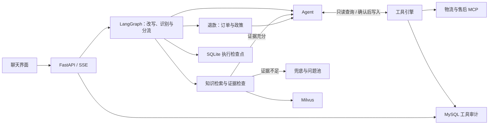

# 电商智能客服

主要将商品政策问答、订单物流查询和退款咨询放在同一个客服会话里。服务端负责路由和关键业务检查；模型负责理解用户问题、选择可用工具和组织答复。

- **政策问答**：向量与关键词混合召回，重排后检查证据；答案附来源，证据不足时走兜底。
- **业务查询**：按用户和订单查询业务快照，通过 MCP 取得物流及售后信息。
- **售后处理**：退款咨询先查订单和适用政策；缺少订单时暂停，等待用户选择。创建工单前显示预览并要求确认。
- **运营工作台**：提供知识导入、低置信问题待审、评估报告及可选的 Langfuse 追踪。工具执行写入 MySQL 审计表。

订单、物流和售后接口随仓库提供的是**模拟服务**。退款咨询可以引导提交工单，不直接执行支付退款。默认部署适用于本机验收或受控内网。

## 架构



| 目录 | 职责 |
| --- | --- |
| `app/api`、`app/static` | API、聊天界面和运营工作台 |
| `app/graph`、`app/core` | 状态编排、检索、证据检查和上下文 |
| `app/tools`、`mcp_servers` | 工具执行、审计和模拟业务服务 |
| `sql`、`data/kb` | 数据库初始化和示例政策知识库 |
| `scripts`、`tests` | 运维脚本、验收和回归测试 |

## 部署

准备 Docker Engine / Docker Desktop（Linux 容器）、Docker Compose，以及兼容 OpenAI 接口的聊天、向量化和重排服务。开发环境使用 Python 3.12 与 uv，依赖锁定在 `uv.lock`。

**1. 配置环境。** 将 `.env.example` 复制为 `.env`（PowerShell 用 `Copy-Item .env.example .env`）。填写模型参数和三个独立的容器密码。数据库应用密码使用 URL 安全字符。

| 配置 | 用途 |
| --- | --- |
| `CHAT_BASE_URL`、`CHAT_MODEL`、`CHAT_API_KEY` | 聊天上游；意图和摘要可复用这组 |
| `EMBED_*`、`RERANK_*` | 知识向量化与精排；默认使用 BGE-M3（1024 维）与 BGE reranker |
| `MYSQL_PASSWORD`、`MYSQL_ROOT_PASSWORD`、`MINIO_PASSWORD` | Compose 数据库与对象存储密码 |
| `APP_PORT` | 本机访问端口，默认 8080 |
| `LANGFUSE_BASE_URL`、`LANGFUSE_PUBLIC_KEY`、`LANGFUSE_SECRET_KEY` | 可选，三项齐全才开启 |
| `MODEL_CONTEXT_WINDOW`、`MAX_OUTPUT_TOKENS` | 可选，按所选模型的真实窗口和输出限制调整 |

**2. 构建、导入样例并启动。**

```sh
docker compose -f compose.release.yml build app
docker compose -f compose.release.yml run --rm kb-init
docker compose -f compose.release.yml up -d --wait
```

首次使用空数据库卷时，MySQL 自动加载 `sql/` 中的建表和种子脚本。导入任务将示例文档切块写入 MySQL，再调用向量化接口写入 Milvus。建议在启动客服前完成该任务。更换嵌入模型时应新建集合并重新建索引。

访问 [客服界面](http://127.0.0.1:8080/) · [运营工作台](http://127.0.0.1:8080/admin) · [API 文档](http://127.0.0.1:8080/docs)。

**3. 执行验收。**

```sh
curl http://127.0.0.1:8080/healthz
curl http://127.0.0.1:8080/readyz
```

Windows PowerShell 可以用 `Invoke-RestMethod` 代替 `curl`。接口返回正常后，按[验收手册](docs/acceptance.md)检查问答、订单物流、退款中断和兜底。

## 开发与运维

- Windows 开发：[本机启动与 VS Code 调试](DEV_WINDOWS.md)。
- 健康检查、日志、数据保留和故障定位：[运行手册](docs/operations.md)。
- 自动回归：[GitHub Actions](.github/workflows/verify.yml)。CI 使用测试配置，不依赖真实模型密钥；上游模型联调按验收手册执行。
- 追踪：本地有决策日志和 MySQL 工具审计；Langfuse 启用后采集图和模型调用。当前不会把所有下游服务自动串成同一条分布式 Trace。

本仓库基于经授权公开的 MewHelp 客服代码整理。交付版本补齐了部署编排、运行探针、环境模板、验收手册和自动回归入口。
